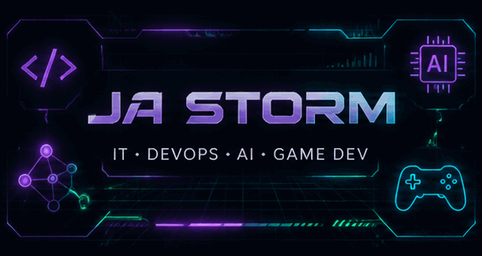

 

---

## 👨‍💻 About Me

Hey! I'm **Ja Storm**, also known as **PsihoPatStorm**.

I explore the intersection of IT infrastructure, DevOps, artificial intelligence, and game development.

My interests range from systems engineering and automation to building interactive digital worlds and experimenting with intelligent NPC systems.

> ⚡ Think. Build. Break. Fix. Improve. Repeat.

## ⚙️ Focus Areas

| Area | Interests |
|---|---|
| 🖥️ IT Infrastructure | Systems, networking, servers and troubleshooting |
| ⚙️ DevOps | Automation, tooling and workflows |
| 🤖 Artificial Intelligence | AI integration and intelligent systems |
| 🎮 Game Development | Gameplay, 3D worlds and NPC behavior |

## 🎮 Featured Game Project

### 🌆 PARADISE LOST DISTRICT

**Multiplayer • Open World • Social RPG**

An indie game project focused on immersive environments, social interaction, evolving gameplay systems, and AI-driven characters.

 

## 🛠️ Technologies & Interests

## 📊 GitHub Activity

 

---

## 🌐 Connect

 

`Code is temporary. Ideas are limitless.`

